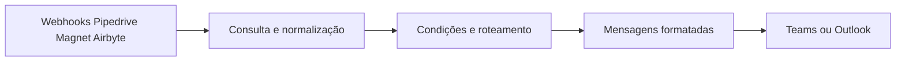
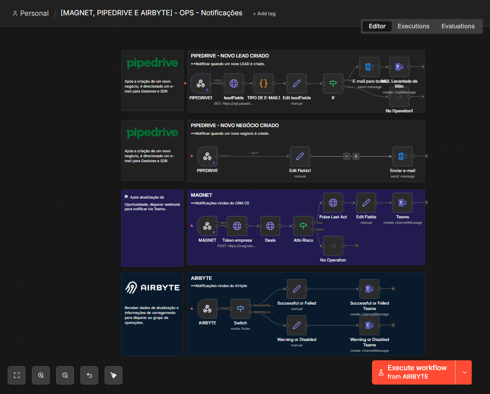

# Notificações operacionais — CRM, Airbyte e Teams

Desenvolvi uma central de notificações com **n8n, webhooks, APIs, JavaScript, HTML, Microsoft Teams e Outlook** para dar visibilidade a eventos comerciais, de customer success e de sincronização de dados.

## Eventos e encaminhamentos

| Origem | Tratamento | Destino |
| --- | --- | --- |
| Pipedrive: lead | Consulta de campos, classificação de e-mail e condições do fluxo | E-mail e Teams |
| Pipedrive: negócio | Organização dos dados do evento | E-mail |
| Magnet Customer | Consulta do negócio e última atividade, verificação de alto risco | Teams |
| Airbyte | Separação de resultados e avisos pelo Switch | Teams |

O fluxo transforma eventos técnicos em mensagens com contexto para a equipe. Os filtros determinam quais notificações são enviadas; não é uma transmissão irrestrita de todos os eventos. Os templates de mensagem e expressões HTML estão preservados com anonimização no JSON.

**Este projeto não utiliza agente de IA nem LLM.** As decisões usam condições, classificação por código e mapeamento de campos.

Não publiquei destinatários, canais privados ou credenciais. Configure esses recursos antes de habilitar a cópia de demonstração.

## Screenshots

Envie os arquivos com os nomes acima para assets/screenshots/. Os links já estão preparados.

## Arquivos e reprodução

- [Template notificacoes](workflows/notificacoes.template.json) — 33 nós.
- [Inventário e códigos notificacoes](docs/inventario-notificacoes.md)
- [Arquitetura e vínculos](docs/arquitetura.md)
- [Configuração](docs/configuracao.md)
- [Preparação pública](docs/publicacao.md)
- [Validação](docs/validacao.md)

## Projetos conectados

- [Lead Guardian e enriquecimento — RD Station → Pipedrive](https://github.com/alosiolemos/n8n-rdstation-pipedrive-lead-guardian)
- [Monitor de falhas — n8n e Microsoft Teams](https://github.com/alosiolemos/n8n-error-monitor-teams-alerts)

Os projetos documentam partes complementares da operação. Seus gatilhos e configurações devem ser associados na instalação de destino.
