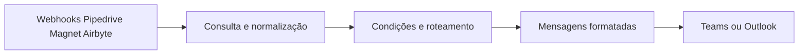

# Arquitetura e vínculos

Desenvolvi uma central de notificações com **n8n, webhooks, APIs, JavaScript, HTML, Microsoft Teams e Outlook** para dar visibilidade a eventos comerciais, de customer success e de sincronização de dados.

## Eventos e encaminhamentos

| Origem | Tratamento | Destino |
| --- | --- | --- |
| Pipedrive: lead | Consulta de campos, classificação de e-mail e condições do fluxo | E-mail e Teams |
| Pipedrive: negócio | Organização dos dados do evento | E-mail |
| Magnet Customer | Consulta do negócio e última atividade, verificação de alto risco | Teams |
| Airbyte | Separação de resultados e avisos pelo Switch | Teams |

O fluxo transforma eventos técnicos em mensagens com contexto para a equipe. Os filtros determinam quais notificações são enviadas; não é uma transmissão irrestrita de todos os eventos. Os templates de mensagem e expressões HTML estão preservados com anonimização no JSON.

**Este projeto não utiliza agente de IA nem LLM.** As decisões usam condições, classificação por código e mapeamento de campos.

Não publiquei destinatários, canais privados ou credenciais. Configure esses recursos antes de habilitar a cópia de demonstração.

## Fronteiras entre sistemas

| Vínculo | Informação transportada |
| --- | --- |
| RD → entrada | Contato e eventos de conversão; uuid para consulta |
| Entrada → Pipedrive | Dados normalizados; referências de pessoa e organização no lead |
| Pipedrive → enriquecimento | Identificador do lead informado no webhook |
| Evento CRM → notificações | Identificador do registro e campos do evento |
| Airbyte → notificações | Estado e contexto da sincronização |
| Workflow → monitor | Configuração errorWorkflow e evento de falha |

Esses vínculos são de integração por API e eventos, não relacionamentos de um modelo Power BI. Nem todas as ligações externas estão materializadas por chamadas diretas entre os JSONs.

O monitor recebe somente falhas elegíveis encaminhadas pelo n8n. Não implementei aqui uma fila de retentativas, compensação de transações ou garantia de entrega exatamente uma vez.
